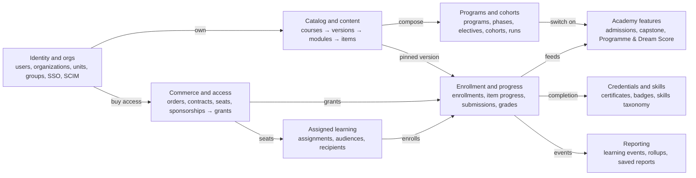
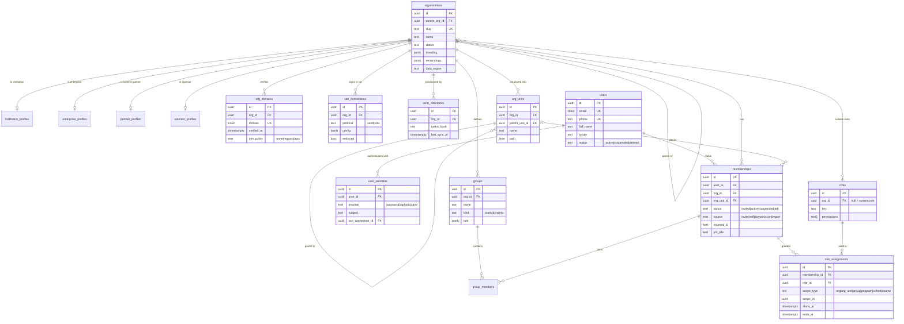
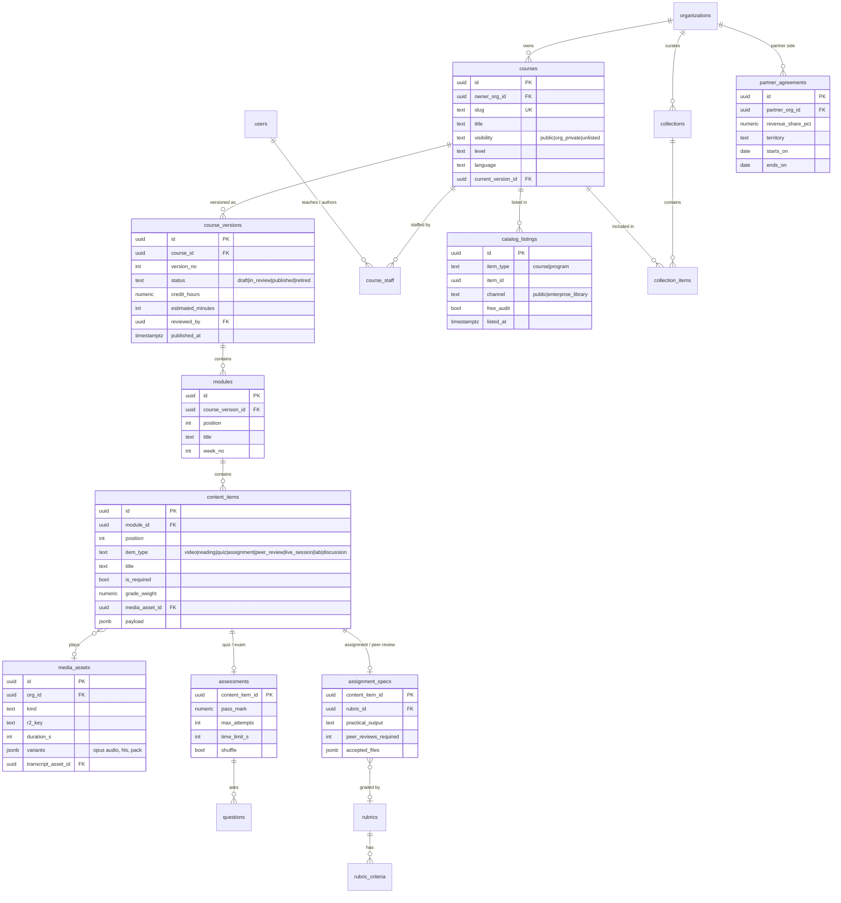
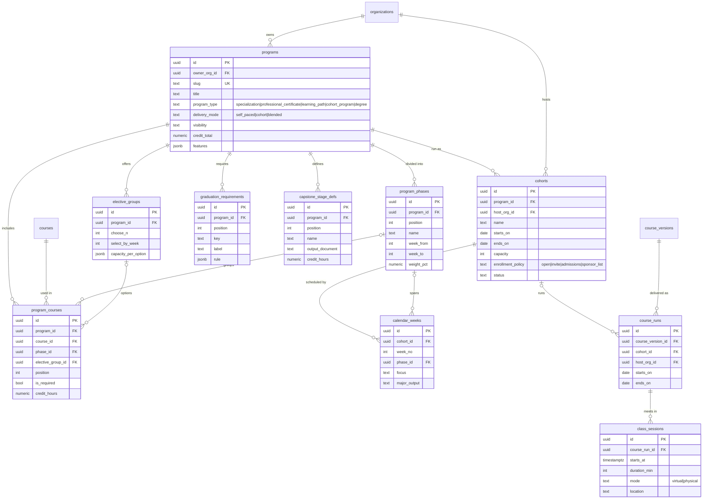
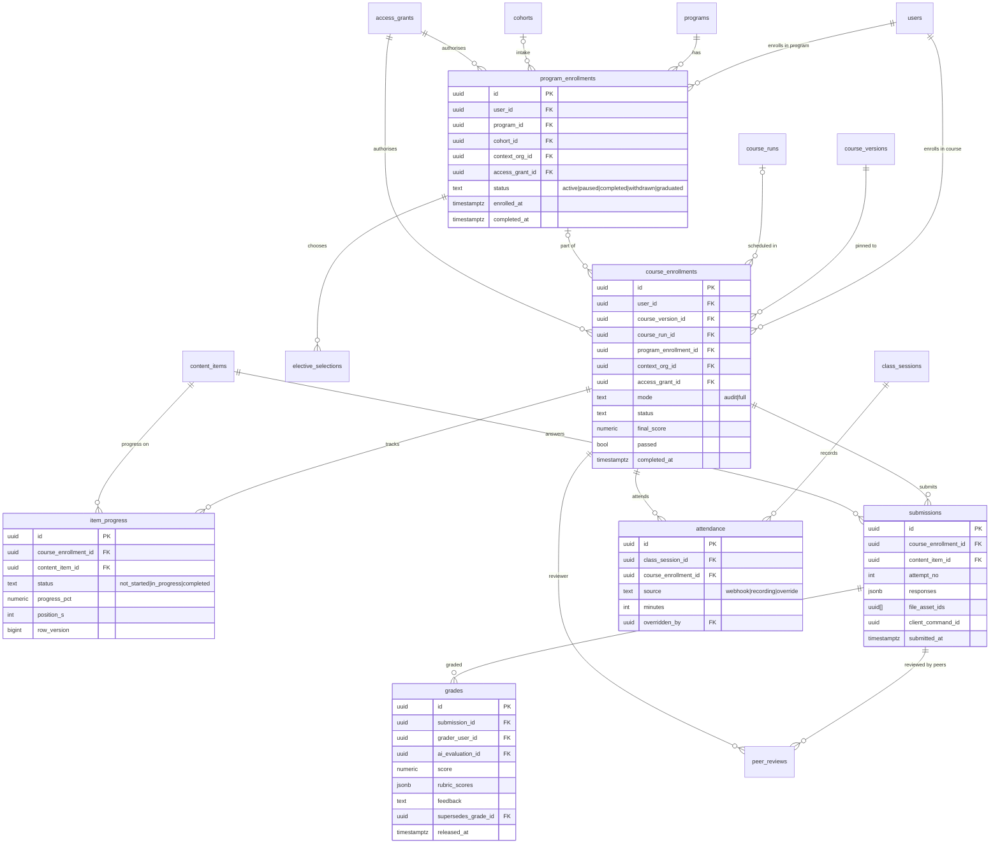
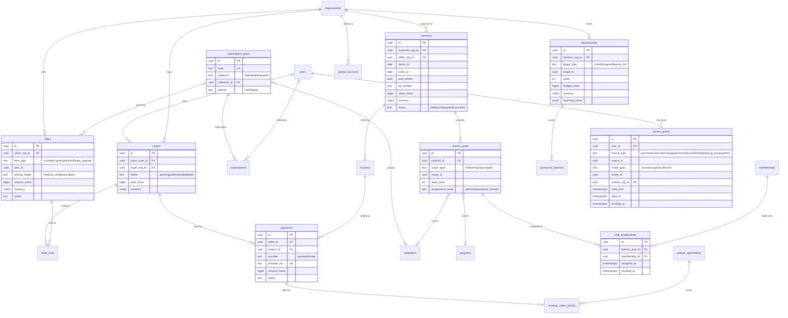
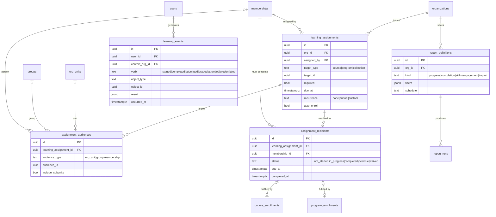
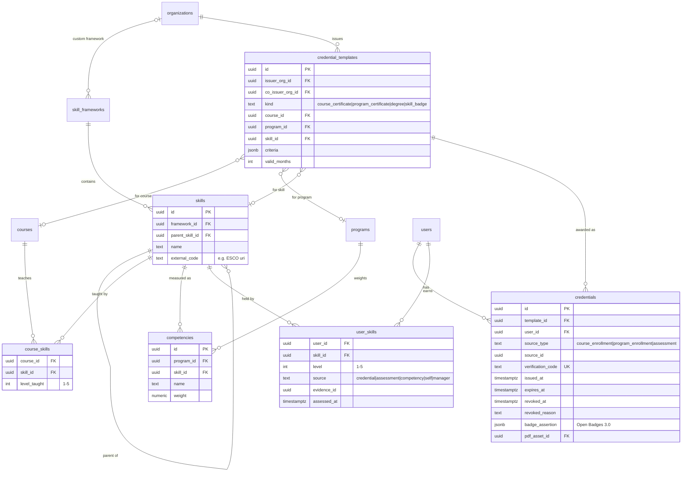
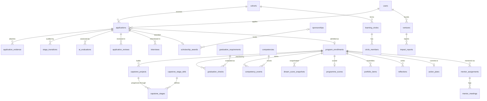

# Dream Lab OS — Starter ERD v0.1

Oct 19, 2026 · Ukeme Ikot · Draft for review. Mirrors the shared planning doc: https://claude.ai/code/artifact/2a4301a8-0b98-4c9a-8e18-da8f08138347

Dream Lab OS becomes a Coursera-style learning platform. It serves individual learners and five kinds of organisation, and it runs The African Dream Lab's 100-credit cohort programme as one program among many. This is starter ERD v0.1, for review before the tenancy schema slice (API-2) is written.

## 1. Decisions this model is built on

| Question | Decision | What it does to the model |
| --- | --- | --- |
| Relationship to Plan v1.1 | Extend: support both models | The academy spine becomes a *program type* with optional features. Nothing in Plan v1.1 is dropped |
| Who the enterprise users are | Companies buying seats, institutions hosting programs, content partners, governments / NGOs / funders | One `organizations` table and one profile table per kind. A single org can hold several kinds |
| Where courses live | Shared catalog plus private org content | Every course has an owner org and a visibility. Learners reach it through an access grant |
| Individual (B2C) learners | Yes, free and paid | Orders, subscriptions and a free audit mode |
| Credentials | Course certificates, program certificates / degrees, skill badges | One credential-template model with three kinds, tied to a skills taxonomy |
| Content depth | Course > Module > Item | Published course versions can't be changed. Items are typed (video, quiz, assignment …) |
| Enterprise capabilities in v0.1 | Seats / licenses / contracts, org hierarchy and groups, SSO / SCIM, assigned learning and reporting | All four are modelled now |

This supersedes two lines of Plan v1.1 §3.3. Pedagogy becomes configurable per program, and selling to individuals brings in a marketplace (open question 1).

## 2. Modelling principles

Seven rules shape every table below. The biggest change from Plan v1.1 is that a row can now belong to three parties: the content owner, the learner, and the org that paid.

1. **One global person.** `users` is global. Everything a person does at an organisation goes through a `membership`, and roles are scoped assignments on it. The applicant → student → alumna → mentor journey keeps one person record (Plan §3.4, unchanged).
2. **The organisation is the tenant.** `institutions` becomes `organizations`, with a profile per kind: institution, enterprise, partner, sponsor, platform. `institution_id` becomes `org_id` on every tenant-owned row.
3. **Three kinds of ownership.** Content belongs to the org that wrote it. Learner records belong to the learner and carry a `context_org_id`: the org through which access was granted, and the one allowed to report on that record. Commercial records belong to the buyer.
4. **Access is a grant.** Every enrollment points at exactly one `access_grant`. The grant's source can be a purchase, subscription, seat, sponsorship, scholarship, free / audit access, or private org content. One check answers "may this person learn this?".
5. **Published versions can't be changed.** Learners are pinned to the `course_version` they enrolled in. Editing a course creates a new draft version.
6. **Records used as evidence are append-only.** This covers submissions, grades (a correction supersedes the old grade), stage transitions, competency events, learning events and audit logs. Credentials are revoked, never deleted.
7. **RLS changes shape.** Row-level security can no longer just check "row.org\_id = current org". Content is visible if the reader's org owns it, is licensed to it, or it is public. Learner data is visible to the learner, to admins of the context org (limited to their unit), and to the owning org's course staff.

Conventions: UUIDv7 primary keys, `created_at` / `updated_at` on every table, money as integer minor units plus an ISO currency code, and status enums instead of hard deletes.

## 3. Domain map

Under every domain: audit logs · outbox · credSync tables · notifications · consent records.

Organisations own content and buy access, and the two meet at enrollment. Enrollment then feeds the academy scores, credentials and reporting. Sections 4–12 detail each box.

## 4. Identity, organisations and enterprise directory

A person joins an organisation through a membership, and a membership gets roles at a scope. Enterprise structure (units, groups, SSO, SCIM) hangs off the organisation, so a company, a university and a funder all use the same tables.

| Rule | Detail |
| --- | --- |
| Org kinds | Each kind is a 0..1 profile table, so a university can be an institution *and* a content partner. `organizations.parent_org_id` covers groups of companies and ministries with agencies |
| Org kinds' own fields | Institution: subdomain, academic calendar. Enterprise: industry, size band, account owner. Partner: payout account, revenue share default. Sponsor: funding type, reporting cadence |
| Hierarchy vs groups | `org_units` is the one reporting tree (department → team) and each membership sits in at most one unit. `groups` cut across it ("2026 graduate hires"). Dynamic groups are rule-based, e.g. unit = Sales and job\_title contains "Manager" |
| Roles | Seeded system roles: learner, applicant, student, alumni, instructor, mentor, grader, author, org\_admin, unit\_admin, analyst, sponsor\_viewer, platform\_admin. Enterprises may define custom roles (`roles.org_id` set) |
| Scope | `role_assignments.scope_type` replaces Plan v1.1's `institution_members.cohort_id`: faculty on one cohort, unit\_admin on one department, author on one course |
| Provisioning | SCIM writes `memberships` (with `external_id`), `org_units` and `group_members`. Deprovisioning sets the membership to `left` and frees its seat; learning records stay with the user |
| Sign-in | A verified `org_domains` row plus `sso_connections.enforced` sends that domain's users to the org's IdP. `join_policy` controls self-join for B2C users from that domain |

## 5. Catalog and content

A course belongs to the org that wrote it. Its content lives in versions that can't be changed once published: Course → Version → Module → Item. Where a course appears (public marketplace, an enterprise library, or private to its owner) is set by its visibility, catalog listings and collections, not by copying it.

| Rule | Detail |
| --- | --- |
| Visibility | `public` = in the shared catalog. `org_private` = the owner org's members plus any org it licenses the course to. `unlisted` = reachable by link and grant only |
| Versions | Status runs draft → in\_review → published → retired. Published rows are read-only, enrollments pin `course_version_id`, and partner content goes through `in_review` before it reaches the public catalog |
| Items | `item_type` picks a detail table: quizzes use `assessments`, assignments and peer reviews use `assignment_specs`, and everything else keeps its details in `payload`. `grade_weight` feeds the course grade and `is_required` feeds completion. `practical_output` carries the Dream Lab "named output" |
| Media | Each asset is stored in R2 under `{org_id}/…` and produced by media-pipeline: Opus audio first, plus transcripts and lesson-pack variants (Plan §10–11) |
| Collections | Curated sets, e.g. "Leadership Library" or "Full catalog". Subscription plans and enterprise license pools grant access to a collection, not to courses one by one |
| Staff | `course_staff.role` is author, instructor or teaching assistant. Grading and course analytics follow this table |

## 6. Programs and cohorts

A program is an ordered set of courses with a type and a set of features you can switch on. The African Dream Lab is a `cohort_program` with every academy feature on. A Coursera-style specialization is a `self_paced` program with none of them. A cohort is one scheduled intake of a program, and it can be hosted by an org other than the program's owner.

| Program feature flag (`programs.features`) | Turns on | Dream Lab | Typical specialization |
| --- | --- | --- | --- |
| `admissions` | Ten-stage application pipeline, AI-assisted scoring | On | Off |
| `scholarships` | Tiered awards, committee review | On | Off |
| `programme_score` | Credit-weighted academic score | On | Off |
| `competency_score` | Dream Score™ radar from competency events | On | Off |
| `capstone` | Staged project workspace (the seven-stage residency) | On | Optional |
| `portfolio` | Auto-assembled portfolio sections | On | Off |
| `graduation_checklist` | Live requirement checks gating the credential | On | Off |
| `mentorship` | Mentor assignments, meeting logs, learning circles | On | Off |

The Dream Lab seed (API-5) is now data in these tables: 4 phases weighted 25 / 20 / 10 / 45, 13 courses in `program_courses`, one elective group with `choose_n = 1`, seven `capstone_stage_defs` worth 5 / 5 / 7 / 10 / 6 / 5 / 7 credits, ten `graduation_requirements`, and the 15-week `calendar_weeks`. `course_runs` with no cohort cover instructor-led runs for an enterprise. Self-paced enrollments have no run.

## 7. Enrollment, progress and assessment

Enrollment is the hub: every way into learning ends in a `program_enrollment` or `course_enrollment` backed by an `access_grant`. Progress and submissions attach to the course enrollment. A program enrollment ties its course enrollments together and becomes Dream Lab's credSync "enrollment" scope.

| Rule | Detail |
| --- | --- |
| `context_org_id` | The org this learning is happening *for*. Its admins can report on it: an employer for a seat, a funder for a sponsorship, an institution for its cohort, and the platform org for B2C |
| Audit mode | `mode = audit` can view content but not submit graded items, and earns no credential. Upgrading swaps the access grant and keeps the progress |
| One learner, many routes | A user can take the same course through an employer seat and later through B2C. These are separate enrollments with separate context orgs, so the employer never sees the personal one |
| Submissions | Append-only. Every attempt is a new row, and a quiz attempt's answers go in `responses`. `client_command_id` links an offline credSync submission back to its command |
| Grades | A regrade inserts a new grade that supersedes the old one. `ai_evaluation_id` links to an immutable AI-assist record when one was used. A human always releases the grade |
| Offline sync | `item_progress` uses last-write-wins per field. `submissions` are append-only. `grades` and `attendance` are pull-only (Plan §7.5 classes, unchanged) |

## 8. Commerce and access

Four routes pay for learning: B2C purchases, subscriptions, enterprise contracts with seat pools, and sponsorships. Each route ends in an `access_grant` row. The grant is the only thing enrollment checks, so adding a new payment route never touches the learning tables.

| Route | Path through the tables | Context org |
| --- | --- | --- |
| B2C one-off | `offers` → `orders` / `order_lines` → `payments` → `access_grants` (purchase) | Platform org |
| B2C subscription | `subscription_plans` → `subscriptions` → `access_grants` (subscription, scope = plan's collection) | Platform org |
| Enterprise | `contracts` → `license_pools` → `seat_assignments` → `access_grants` (seat) | The enterprise |
| Sponsor / funder | `sponsorships` → `sponsored_learners` → `access_grants` (sponsorship) | The sponsor, read-only through `sponsor_viewer` |
| Scholarship (Dream Lab) | `scholarship_awards` (§11) → `access_grants` (scholarship) + an `invoice` for the unfunded share | The institution |
| Private org content | Membership of the owner org → `access_grants` (org\_private) | The owner org |

Revoking a seat sets `revoked_at` on both the seat and its grant. The learner keeps their progress and any credential they already earned. Payments use Paystack first. `provider` is a column so Stripe can be added for USD customers. `payout_accounts` holds each seller's Paystack subaccount, so payments can be split at charge time (open question 1).

## 9. Assigned learning and reporting

An admin assigns a course, program or collection to an audience: a unit, a group or named members. Each assignment is resolved into one recipient row per person, so that "who is overdue" is a simple query. Reporting reads an append-only `learning_events` stream and the rollups built from it, never the live tables.

| Rule | Detail |
| --- | --- |
| Resolution | Recipients are recomputed when an assignment is created, when a group or unit membership changes (including through SCIM), and nightly. A person who leaves the audience keeps their row, marked `waived` |
| Auto-enroll | With `auto_enroll`, resolution also creates the enrollment, using the org's seat, so the learner just finds the course on their dashboard |
| Events | `learning_events` are written through the outbox in the same transaction as the change. Their shape follows xAPI (actor, verb, object, result), so they can be exported to an enterprise's LRS later. They also feed `competency_events` |
| Rollups | `learner_activity_daily`, `assignment_status_by_unit` and `org_skill_snapshots` are read models rebuilt from events, not sources of truth. They are not drawn above |
| Who sees what | Org admins see records whose `context_org_id` is their org. Unit admins see their subtree. Sponsors see their funded learners plus verified impact. Content partners see aggregates for their own courses (open question 2) |

## 10. Credentials and skills

One `credential_templates` table covers all three kinds of credential: course certificates, program certificates and degrees, and skill badges. Each issued credential gets a public verification code. Courses, credentials and the Dream Score dimensions all point at one skills taxonomy, so enterprise skill reports and the academy's competency engine use the same language.

| Rule | Detail |
| --- | --- |
| Criteria | Course certificate: course passed in `full` mode. Program certificate or degree: all required courses passed, plus every `graduation_requirements` check when that feature is on. Skill badge: a passing score on a tagged assessment |
| Co-issuing | A partner's course run inside an institution's program can carry both logos (`co_issuer_org_id`) |
| Verification | A public `/verify/{verification_code}` page that needs no login. Revoked credentials stay listed, marked revoked with the reason |
| Dream Lab graduation | The program credential for the African Dream Lab program. Issuing it is the state change Plan §3.2 gated on all ten requirements |
| Skills sources | `user_skills` is updated from credentials, assessments, the competency engine, self-rating and manager rating. Every row keeps its source, so reports can filter out self-reported levels |

## 11. Academy features carried from Plan v1.1

Every table in Plan v1.1 §8 survives. They now hang off `cohorts` and `program_enrollments` instead of a single institution, so any program that turns a feature on can use them. Two groups are generalised: residency becomes a capstone, and graduation requirements become per-program data.

| Plan v1.1 group | Tables | Change in v0.1 |
| --- | --- | --- |
| Admissions | applications, application\_evidence, application\_reviews, ai\_evaluations, interviews, stage\_transitions | Applications attach to a cohort, not an institution. The ten-stage pipeline stays fixed. Admission creates the program enrollment |
| Scholarships | scholarship\_awards | Can name a sponsorship as its funding source. An award creates a scholarship access grant plus an invoice for the unfunded share |
| Scoring | competencies, competency\_events, dream\_score\_snapshots, programme\_scores | Competencies map to skills. The Programme Score is computed from `program_courses.credit_hours` × course scores. Both engines stay explainable and recomputable |
| Residency | residency\_projects, residency\_stages | Renamed `capstone_projects` / `capstone_stages`, checked against per-program `capstone_stage_defs`. Dream Lab's seven stages become seed data |
| Portfolio | portfolio\_items, reflections, action\_plans | Scoped to the program enrollment. The section list is set per program, with Dream Lab's eight sections as seed data |
| Graduation | graduation\_checks | Checks a per-program `graduation_requirements` list. All passing → the program credential is issued |
| Community | mentor\_assignments, mentor\_meetings, dream\_circles, circle\_members, peer\_reviews | `dream_circles` → `learning_circles` (renamed per tenant through `terminology`). Peer reviews move into assessment (§7) |
| Meetings | meeting\_rooms, meeting\_events, recordings | A room is owned by a class session, a mentor meeting or a `live_session` content item. A recording becomes a media asset |
| Impact | ventures, impact\_reports, verifications | Sponsors can read verified reports from the learners they funded |

## 12. Platform plumbing

These tables sit under every domain. Most are unchanged from Plan v1.1. Three are new: consent records, data-subject requests and enterprise integrations. The credSync scopes also change, because content can now be shared across tenants.

| Table | Purpose | Change from Plan v1.1 |
| --- | --- | --- |
| `audit_logs` | Actor, org, action, target, before/after hash, time. Append-only | Actor's acting org and role recorded, because one user can act for several orgs |
| `outbox` | Domain events written in the state-change transaction and drained by BullMQ | Also feeds `learning_events` |
| `sync_changes`, `sync_command_results` | credSync's server-side tables | Scopes become (org, program\_enrollment), (org, course\_enrollment) and (course\_version) for shared catalog content. See open question 9 |
| `notifications`, `notification_deliveries` | notify-hub fallback chain: push → WhatsApp → SMS → email, with delivery receipts | Per-org sender branding, and metering per org |
| `consent_records` | NDPA consent: purpose, policy version, granted / withdrawn, guardian fields | New. Covers AI-assisted evaluation and sharing data with an employer or sponsor |
| `data_subject_requests` | Export and deletion requests and their outcomes | New. A deletion anonymises learner records but keeps credentials verifiable |
| `integrations` | Per-org connections: HRIS, LTI, SCORM import, webhooks, LRS export | New. Modelled now, built later |

## 13. Open questions and effect on the build plan

Ten questions are still open. Each one has a working assumption that the model above already uses, so the ERD can move forward while they are settled.

| # | Question | Working assumption |
| --- | --- | --- |
| 1 | Selling partner and institution courses to individuals is a marketplace. Plan v1.1 §3.3 says the platform never holds institution money | Payments are split at charge time through Paystack subaccounts, so the platform never holds other orgs' money |
| 2 | Can a content partner see named enterprise learners' grades, or only aggregates? | Graders see the submissions they grade. Otherwise partners see aggregates only |
| 3 | Does a learner move to a new course version mid-course? | No: they stay pinned and may opt in to switch |
| 4 | Do programs need versions (curriculum changes between Cohort 04 and 05)? | Yes. Add `program_versions` in v0.2 |
| 5 | Is the African Dream Network the platform org that owns the shared catalog and the B2C context? | Yes |
| 6 | Currencies and payment providers: NGN-only through Paystack, or USD through Stripe as well for international enterprises and sponsors? | NGN first, with the `provider` column ready for more |
| 7 | Skills taxonomy: build our own, or adopt ESCO / O\*NET / Lightcast as the base? | Adopt ESCO as the base and allow org frameworks on top |
| 8 | Must enterprises import SCORM / xAPI / LTI content in v1? | No. Modelled in `integrations`, built later |
| 9 | Offline sync for self-paced B2C learners: which scopes, and is shared content synced per course version? | Same entity classes as Dream Lab, with an added course\_version content scope |
| 10 | Enterprise custom roles in v1, or system roles only? | System roles in v1. The table already allows custom ones |

**Effect on the build plan**

- **API-2 changes before it starts.** The tenancy and identity slice becomes `organizations`, the profile tables, `memberships`, `roles` and `role_assignments` instead of `institutions` / `institution_members`. The cross-tenant leak test must also cover shared content and `context_org_id` visibility.
- **API-5 becomes data.** The curriculum seed fills `programs`, `program_phases`, `program_courses`, `capstone_stage_defs`, `graduation_requirements` and `calendar_weeks`, still with the same 100-credit asserts.
- **Ship in Dream Lab order.** The generic shape goes in now, but features ship in the order Deadlines A and B require. Enterprise seats, SSO / SCIM, B2C checkout and partner publishing come after Cohort 04 starts, as new phases after P7.
- **contracts package.** `@dreamlab/contracts` needs the org / membership / access-grant types before any client slice is written.
- **Next step.** Review this ERD, settle the ten questions, then rewrite the P0 slices against v0.2.
